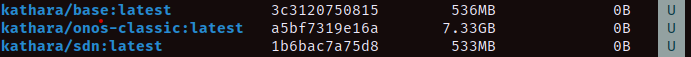
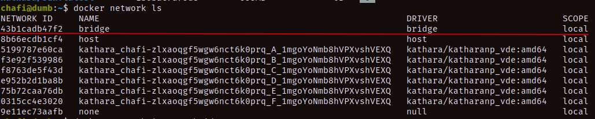
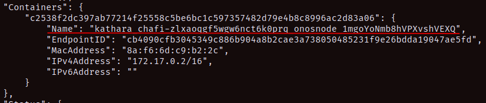
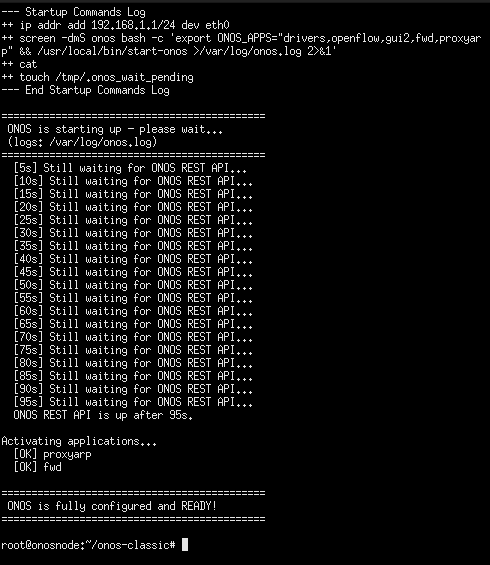
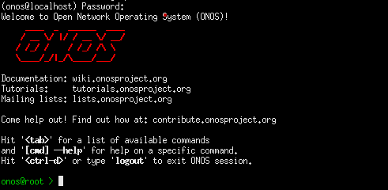
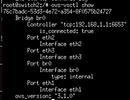
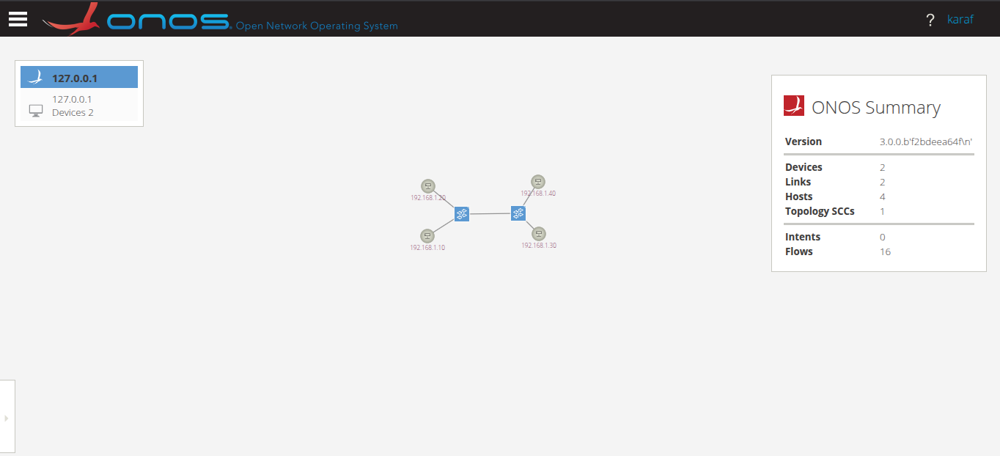

# About

A simple lab exercise with 2 `OVS` switches and 4 `hosts`.

## For the Lab

1. **Setting up Kathará:**
   - make sure you have `katharà` available

2. **Building the `katharàXonos` image:**
   - follow this [tutorial](https://github.com/ONOS-resurrection-project/katharaXonos/tree/master)

3. **Start the Lab:**

   ```bash
   # from the "onos-ovs" folder
   kathara lstart
   ```

## How Does Everything Work Under the Hood?

1. **Creating `onosnode` using Kathará:**
   - When we executed the `startKatharaXonos.sh` script, it built an image containing ONOS directly on top of `kathara/core`. This ensures that the ONOS and Kathará environments seamlessly coexist. Any OpenFlow traffic traveling from a Kathará switch node to ONOS will no longer be intercepted by the host Linux machine's firewall. Instead, it travels strictly through Kathará's virtual Layer-2 LANs (collision domains). If we check the Docker images using the `docker images` command, we will find `kathara/onos-classic` on the list:

     

2. **Setting up `lab.conf`:**
   - Now that we have the `kathara/onos-classic` image, we can define it within Kathará to launch our ONOS SDN Controller. _(Note: In my case, Kathará is installed in a virtual Python environment. Your setup may vary slightly, but the ultimate goal is to have the Kathará executable ready to parse our `lab.conf` scripts)._

   - In our [lab.conf](lab.conf), we have the following setup for `onosnode`:

     ```text
     onosnode[image]="kathara/onos-classic"
     onosnode[bridged]=true
     onosnode[port]="8181:8181/tcp"
     onosnode[0]="A"
     ```

### What did we do here?

1. `onosnode[image]="kathara/onos-classic"`: Specified our custom image for the controller node.
2. `onosnode[bridged]=true`: By default, Kathará strictly isolates its nodes into closed collision domains. Because we need to expose the 8181 port to our localhost, we must bind the node to Docker's default NAT bridge network. To validate this, we can inspect our networks using the command `docker network ls`:

   

3. If we inspect the `bridge` network using the command `docker network inspect bridge`:

   

   We can see that the `onosnode` container is listed under that network. This ensures that web traffic can be routed to the host machine. **_Take note of the `IP: 172.17.0.2/16` that the container acquired from this specific bridge network._**

4. Next, we defined the `ovs-switches` and `hosts` in the configuration. The critical step is assigning them to specific `collision domains`. This `collision domain` architecture is the core feature that allows Kathará to emulate physical Layer-2 wiring.

5. If we look at [onosnode.startup](onosnode.startup), we can see a couple of custom commands. These are essential for automation:
   - ONOS goes through a sequence of heavy initialization steps before starting up. Because we are booting it unattended as a Kathará node, we had to ensure those steps execute cleanly.
   - To solve this, I designed a loop that puts the terminal on hold until ONOS is fully booted, the necessary REST API apps are activated, and the port mapping is complete.
   - This is why, when we execute [lab.conf](lab.conf), a terminal window pops up showing these status steps:

   - `ONOS` ready:

     

   - Once ONOS is ready, the script releases the terminal back to your control.
   - From that terminal, you can execute `onos localhost` to access the CLI using the password `rocks`:

     

   - Finally, we configured the `openVswitch` nodes. Modern ONOS controllers prefer to communicate using specific, newer dialects of OpenFlow. If we look at [switch.startup](switch.startup), we can see that the OpenFlow version is explicitly defined using the `ovs-vsctl set bridge br0 protocols=OpenFlow13,OpenFlow14` command. If we run `ovs-vsctl show` from any of the switch terminals, we see the following output:

     

   - Because we see `is_connected: true` under the `Controller` section, we can definitively confirm that the controller is successfully communicating with the switches using the correct protocols over the virtual wire!
   - You can now try to ping the hosts (`pcX`s) using their IP addresses to test the data plane. Afterward, check the ONOS Web UI using the following details:
     - **URL:** `http://localhost:8181/onos/ui/login.html`
     - **USER:** `onos`
     - **PASS:** `rocks`
     - _(Tip: Press `H` on your keyboard to make the hosts visible in the topology view)._

- You should be greeted with the following view:

  

---
